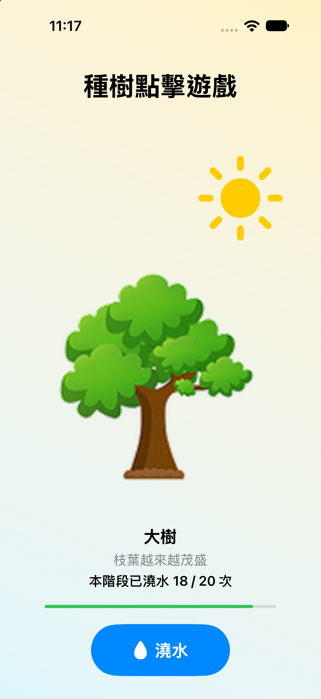

  <h1> 🌳 TreeGrowing 種樹點擊遊戲 </h1>
  

    
    
    
  

  
<b>一個用 SwiftUI State 打造的互動小遊戲：澆水，看種子慢慢長成大樹 🌱➡️🌳</b>

  
👉 <a href="">查看 Medium 報告</a>

---

## 📸 作品展示 (Picture)

  

## 🎮 遊戲玩法 (How to Play)
 
1. 一開始只有一顆種子，按下 **「澆水」** 按鈕就會澆水一次。
2. 每個階段要澆 **20 次**，進度條滿了會歸零，並進入下一個階段。
3. 總共 **100 次** 澆水，種子會依序長成發芽、幼苗、小樹，最後變成開滿枝葉的大樹。
4. 種完之後澆水按鈕會停用，可以點擊畫面上方 **「重新種一棵」** 的按鈕來重新遊玩。

## 📚 作業說明 (Assignment Details)

此為 **iOS App 程式設計課程作業** —— **「用狀態 (State) 設計互動的 SwiftUI App」**。 
專案主要目標是透過實作來熟悉 SwiftUI，包含：
- 狀態設計：由 @State 儲存主要變化的資料（澆水次數），其他像階段、進度、圖片、文字則用 computed property 根據 @State 計算出來。
- 文字圖片：Text、Image、asset、SF Symbol...
- 互動物件(Button)：buttonStyle、tint、label...

以及一些課程講義外的學習內容，包含：
- 動畫：withAnimation、keyframeAnimator...
- 非同步與生命週期：Task、sleep、onAppear、await...

📖 **Medium 文章連結：** 👉 [[點此閱讀完整心得報告]]()
